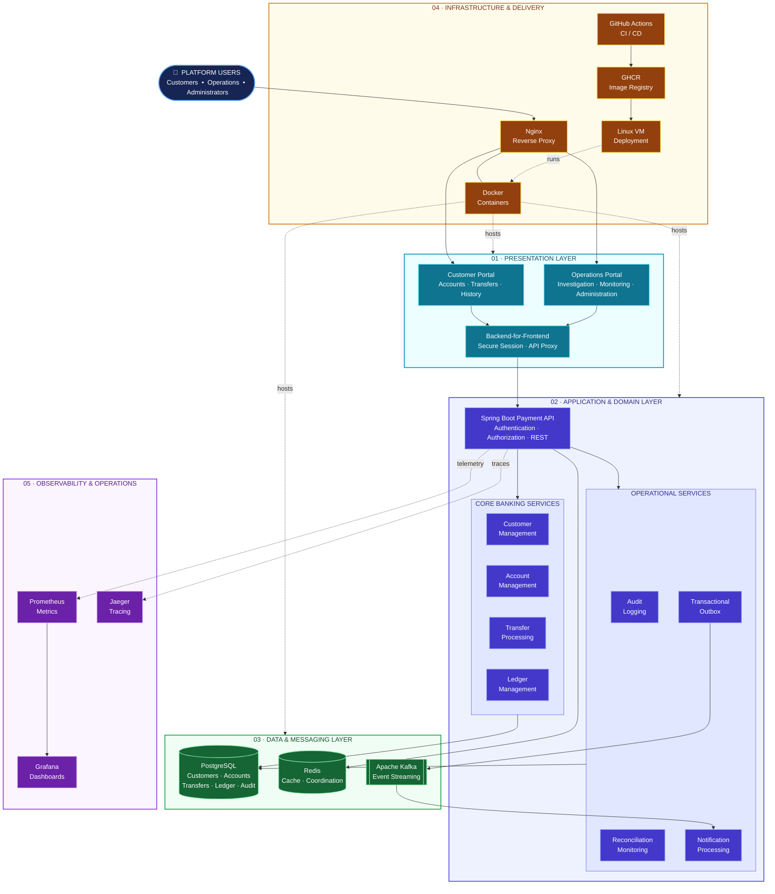

# Enterprise Payment Platform

A portfolio-grade simulated banking and payment platform demonstrating senior-level Java engineering: transactional correctness, concurrency control, idempotency, double-entry accounting, transactional outbox/event-driven integration, identity/security, auditability, reconciliation and operational resilience.

> **Disclaimer:** Educational simulation only. It is not intended to hold, transfer or process real customer funds.

## Project status

| Phase | Scope | Current status |
|---|---|---|
| 0 | Foundation, architecture, requirements, schema and local infrastructure | Completed |
| 1 | Customers, accounts and balance APIs | Completed |
| 2 | Transfers, double-entry ledger, concurrency and idempotency | Completed |
| 3 | Transactional outbox, Kafka publisher/consumer and notifications | Completed |
| 4.1–4.7 | JWT/RBAC, audit, reconciliation, dependency resilience, outbox operations, API error handling and Redis rate limiting | Completed |
| 5.1 | Observability | User-reported complete |
| 5.2 | Performance and load testing | User-reported complete; retain actual run evidence and measured results |
| 5.3 | Containerization and deployment readiness | User-verified complete |
| 5.4 | CI/CD and production-readiness baseline | User-verified complete |
| 6.0 | Frontend foundation and portal shells | User-verified complete |
| 6.1 | Authentication, encrypted BFF session, refresh rotation and RBAC route protection | User-verified complete |
| 6.2 | Customer accounts, balances, transfers, activity and notifications | User-verified complete |
| 6.3 | Operations/Admin Portal and privileged operational workflows | User-verified complete |
| 6.4 | Frontend unit, integration, E2E, security, accessibility and responsive verification foundation | User-verified complete |
| 6.5 | Frontend Docker deployment, Nginx reverse proxy, GHCR publishing, staging/production CI/CD and rollback | User-verified complete |

A phase being implemented or completed does not mean the system is certified for real-money, regulated or high-availability production use. See the relevant phase guide for verification boundaries.

## Phase 6 completion status

**Phases 6.0–6.5 are user-verified complete.** This includes the frontend foundation, authentication and authorization, Customer Banking Portal, Operations/Admin Portal, frontend quality/integration testing, and frontend production deployment/CI/CD. The canonical scope and repeatable regression instructions are in [`docs/phase-6.md`](docs/phase-6.md).

## High-level system architecture

This is the high-level runtime view. The complementary **Technology Stack** diagram is maintained in the Context section of [`docs/architecture/system-architecture.md`](docs/architecture/system-architecture.md).

The platform is organized into five logical layers. This view explains how the customer-facing and operations experiences connect to the payment application, how the application uses persistent data and messaging, and how the platform is deployed and observed.



### How to read this architecture

| Layer | Responsibility | Main components |
|---|---|---|
| **01 · Presentation** | Provides role-oriented user experiences and secure server-side session handling. | Next.js Customer Portal, Operations Portal, Backend-for-Frontend (BFF) |
| **02 · Application & Domain** | Exposes secured APIs and implements payment, account, ledger and operational business capabilities. | Spring Boot Payment API, Customer, Account, Transfer, Ledger, Audit, Reconciliation, Notification and Outbox services |
| **03 · Data & Messaging** | Persists financial and operational records, supports coordination, and transports asynchronous events. | PostgreSQL, Redis, Apache Kafka |
| **04 · Infrastructure & Delivery** | Provides the reverse-proxy entry point, container runtime and automated image delivery/deployment path. | Nginx, Docker, GitHub Actions, GitHub Container Registry (GHCR), Linux VM |
| **05 · Observability & Operations** | Collects application metrics and distributed traces and makes metrics available for dashboards. | Prometheus, Grafana, Jaeger |

### Primary request flow

1. A customer, operations user or administrator accesses the platform through the Nginx reverse proxy.
2. Nginx routes the browser request to the Next.js Customer Portal or Operations Portal.
3. The portal uses the Next.js BFF for same-origin API access and secure session handling. Backend access tokens remain server-side rather than being exposed to browser JavaScript.
4. The BFF forwards the API request to the Spring Boot Payment API.
5. Spring Security authenticates the request and enforces role-based authorization. Domain services apply the relevant business rules and ownership checks.
6. Core banking operations persist their authoritative records in PostgreSQL. Redis supports cache/coordination use cases; it is not the system of record for balances or ledger entries.
7. The transactional outbox publishes committed business events to Kafka. Event consumers, including notification processing, handle asynchronous work.
8. Application telemetry is sent to the observability components for metrics and distributed tracing.

### Layer responsibilities and design boundaries

- **PostgreSQL is the financial system of record.** Account, transfer, ledger and audit data are persisted transactionally. Redis must not be treated as authoritative financial state.
- **The BFF is a browser-facing security boundary.** It manages the encrypted HttpOnly session cookie and proxies requests to the backend. Spring Security remains responsible for backend authentication and authorization.
- **The ledger is the accounting record.** Transfer processing and ledger posting are backend responsibilities; the frontend only initiates requests and displays results.
- **Kafka supports asynchronous integration.** The transactional outbox pattern bridges committed database changes to event publication, avoiding a direct dual-write dependency between the database transaction and broker.
- **Operations capabilities are controlled workflows.** Reconciliation, audit inspection, outbox operations and replay actions are protected by backend authorization and should be performed deliberately.

### Diagram notation and scope

- **Solid arrows** represent the main logical request, data-access or event-processing relationships.
- **Dotted arrows** represent hosting, deployment or telemetry relationships; they are not synchronous business API calls.
- The infrastructure layer is shown as a supporting platform view. The diagram is a high-level logical architecture, not a complete network topology, Kubernetes diagram or exhaustive deployment sequence.
- The diagram intentionally groups related backend capabilities. It does not imply that each capability is deployed as an independent microservice; they are capabilities within the current Spring Boot payment application.

For deployment-specific details, see [Deployment architecture](docs/architecture/deployment-diagram.md). For the detailed application design, see [System architecture](docs/architecture/system-architecture.md).

## Technology baseline

| Area | Technology |
|---|---|
| Language/runtime | Java 21 LTS |
| Framework | Spring Boot 4.0.0 |
| Build | Maven |
| Persistence | Spring Data JPA / Hibernate and JDBC where appropriate |
| System of record | PostgreSQL 17 / Flyway |
| Messaging | Apache Kafka (KRaft in Compose) |
| Ephemeral coordination | Redis 7 |
| Security | Spring Security, RSA-signed JWT, BCrypt |
| Testing | JUnit 5, Mockito, Testcontainers |
| Observability | Actuator, Micrometer, Prometheus, Grafana, OpenTelemetry/Jaeger |
| Performance | k6 (native Windows installation) |
| Delivery | GitHub Actions, GHCR, Docker Compose on Linux VMs |
| Frontend | Next.js 15, TypeScript, Tailwind CSS, TanStack Query |

Versions are pinned in `pom.xml` and `docker-compose.yml`.

## Repository layout

```text
enterprise-payment-platform/
├── .github/workflows/          # CI, image publishing, production deployment
├── frontend/                  # Next.js customer and operations portals (Phase 6)
├── src/main/java/              # Spring Boot application
├── src/main/resources/
│   ├── application.yml
│   ├── application-docker.yml
│   └── db/migration/           # Append-only Flyway migrations V1–V7
├── src/test/java/              # Unit and integration tests
├── docs/
│   ├── phase-0.md ... phase-4.md
│   ├── phase-4-api-examples.md
│   ├── phase-5.md              # Single source of truth for all Phase 5 work
│   ├── phase-6.md              # Single source of truth for all Phase 6 work
│   ├── architecture/
│   ├── database/
│   ├── api/
│   ├── requirements/
│   └── interview/
├── load-tests/                 # k6 workloads and SQL diagnostics
├── scripts/                    # PowerShell and Linux deployment scripts
├── observability/              # Prometheus/Grafana provisioning
├── Dockerfile
├── docker-compose.yml
├── pom.xml
├── AGENTS.md
└── README.md
```

## Prerequisites

- JDK 21
- Maven 3.9+
- Docker Desktop with Docker Compose v2
- Git
- Optional: IntelliJ IDEA and OpenCode

Verify on Windows PowerShell:

```powershell
java -version
mvn -version
docker version
docker compose version
```

## Quick start — Windows PowerShell

1. Copy `.env.example` to `.env` and replace placeholders with local-only values. If PostgreSQL has already initialized a persistent volume, the role password stored in PostgreSQL must match `POSTGRES_PASSWORD`; changing `.env` alone does not rotate an existing database role password.
2. Generate local observability configuration and the Prometheus metrics password file:

```powershell
.\scripts\setup-observability.ps1
```

3. Start infrastructure dependencies:

```powershell
docker compose config --quiet
docker compose up -d
docker compose ps
```

4. Run the automated tests:

```powershell
mvn clean verify
```

5. Start the API on the Windows host with `.env` values loaded:

```powershell
.\scripts\run-local-api.ps1
```

6. Check health:

```powershell
Invoke-RestMethod http://localhost:8080/actuator/health
```

To run the API in Docker instead, provision local JWT files under `.secrets/`, then use `scripts/deploy-local-stack.ps1` and `scripts/verify-deployment.ps1`. For the containerized API, the datasource host is the Compose service `postgres`, not `localhost`. Do not run `docker compose down -v` as a troubleshooting step; it removes persistent data volumes.

## Database migration policy

Flyway migrations are append-only. The current sequence is V1–V7: foundational schema; transfer integrity; outbox/notifications; identity and reconciliation; operations hardening; local operations/admin test fixture; observability trace/correlation context.

**Never edit a migration already applied/shared in an environment.** Add a new migration with the next version. Hibernate uses `ddl-auto: validate`; it does not own schema changes. Verify history with:

```sql
SELECT version, description, success
FROM flyway_schema_history
ORDER BY installed_rank;
```

## Security and secrets

The checked-in RSA key pair is for local development only. Use unique staging and production keys provisioned securely. Never commit `.env`, `.secrets/`, private keys, access/refresh tokens, backups or real customer data. Public registration grants only `CUSTOMER`. The frontend BFF uses a unique server-only `SESSION_SECRET` (32+ characters) to encrypt its HttpOnly session cookie; never expose it through `NEXT_PUBLIC_*` or commit it. PostgreSQL remains the financial system of record; Redis is not authoritative for balances, ledger posting or idempotency.

## Documentation map

- [Phase 0 — Foundation](docs/phase-0.md)
- [Phase 1 — Customers and Accounts](docs/phase-1.md) · [API examples](docs/phase-1-api-examples.md)
- [Phase 2 — Transfers and Ledger](docs/phase-2.md) · [API examples](docs/phase-2-api-examples.md)
- [Phase 3 — Outbox, Kafka and Notifications](docs/phase-3.md) · [API examples](docs/phase-3-api-examples.md)
- [Phase 4 — Security, Audit, Reconciliation, Resilience and Rate Limiting](docs/phase-4.md) · [API/Postman guide](docs/phase-4-api-examples.md)
- **[Phase 5 — Single source of truth: Observability, Performance, Deployment and CI/CD](docs/phase-5.md)**
- **[Phase 6 — Frontend Application and Full-Stack Integration](docs/phase-6.md)**
- [Frontend application README](frontend/README.md)
- [API specification](docs/api/api-specification.md)
- [System architecture](docs/architecture/system-architecture.md) — Technology Stack diagram in Context, runtime context, module boundaries and consistency/security design · [Deployment architecture](docs/architecture/deployment-diagram.md)
- [Database design](docs/database/database-design.md)

### Phase 5 documentation rule

`docs/phase-5.md` is the sole authoritative Phase 5 document for 5.1–5.4. `docs/phase-6.md` is the sole authoritative Phase 6 document for 6.0–6.5. Update these canonical guides rather than creating competing phase runbooks.

## Development rules

1. Read `AGENTS.md` and the relevant phase document before changing code.
2. Update the canonical phase document and this README when implementation scope/status changes.
3. Add tests for new business/security behavior.
4. Add new Flyway migrations; never rewrite applied migrations.
5. Preserve existing API contracts unless a documented, versioned change is intended.
6. Never mutate posted ledger entries; use compensating entries.
7. Do not log credentials, tokens or sensitive payment data.
8. Record material architecture changes as ADRs.
9. Report build/test results honestly; distinguish static checks from tests actually executed.

## Frontend quick start (Phase 6.0–6.5)

```powershell
cd frontend
Copy-Item .env.example .env.local
npm install
npm run dev
```

The checked-in `frontend/.env.example` contains a public local-development sample only. Replace `SESSION_SECRET` with a unique secret before using any shared, staging or production environment. Open `http://localhost:3000` and sign in using a provisioned test identity. Both the Customer Portal and Operations/Admin Portal are implemented. See [Phase 6](docs/phase-6.md) for the complete 6.0–6.5 scope, API contracts, security design and verification.

## Postman collections

Import the Phase 1, Phase 2, Phase 3, Phase 4 and Phase 5.1 collections together with `Enterprise-Payment-Platform-Local.postman_environment.json`. These are the canonical API regression collections for capabilities delivered in Phases 1–5. Phase 6 Postman collections contain additive coverage only: `Enterprise-Payment-Platform-Phase6.postman_collection.json` verifies authenticated CUSTOMER account-list scoping, while `Enterprise-Payment-Platform-Phase6.3-Operations.postman_collection.json` verifies privileged customer-account listing and CUSTOMER denial of customer lookup. Login, identity, account details/balances, transfers, notifications, reconciliation, audit, outbox and Kafka replay tests are intentionally not duplicated. For Phase 6 checks, copy the appropriate CUSTOMER / OPERATIONS / ADMIN access token from the Phase 4 collection into the Phase 6 collection variables as described in [Phase 6 verification](docs/phase-6.md). Run the canonical collections in phase order and use dedicated test accounts.


## Frontend Phase 6.3–6.4

The Operations/Admin Portal and frontend quality-test foundation are user-verified complete. See `docs/phase-6.md` for the full screen-to-API mapping, known backend endpoint limitations, security boundaries, and Windows regression commands.


## Phase 6 frontend deployment

The customer and operations Next.js portals are integrated with the API through the opt-in Compose `deployment` profile. Configure a unique `FRONTEND_SESSION_SECRET` in `.env` (the checked-in sample is public and must be replaced outside local development), then follow the Phase 6.5 deployment and CI/CD instructions in [`docs/phase-6.md`](docs/phase-6.md#phase-65--frontend-production-deployment-and-cicd-integration). Phase 6.5 implementation and deployment verification are user-verified complete. Public production access must use HTTPS terminated by a trusted external proxy/load balancer.
