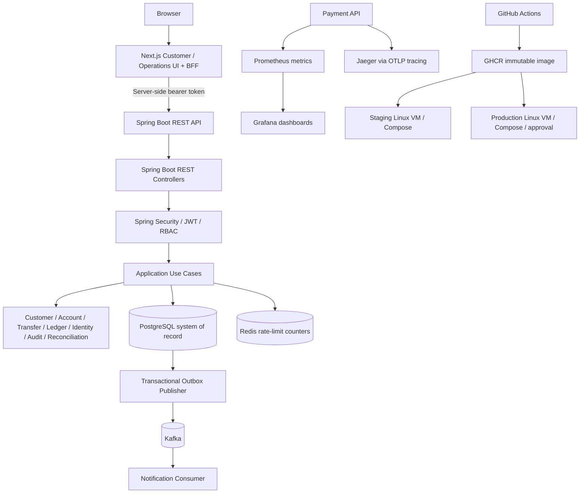

# Component Diagram — Current Implemented Architecture

The application remains a modular monolith. PostgreSQL owns financial state; Redis is non-authoritative and used for rate-limit counters. The outbox makes event intent durable in the same database transaction as the business state; Kafka delivery is at-least-once and consumers deduplicate. Phase 5 adds observability and CI/CD without extracting the business modules into microservices.

Phase 6.1 keeps access and refresh tokens in an encrypted HttpOnly session cookie and proxies API requests server-side. Phase 6.2 adds a customer-scoped account list and notification ownership checks. See [System Architecture](system-architecture.md) and the [single Phase 5 source of truth](../phase-5.md) for current runtime and delivery topology.
