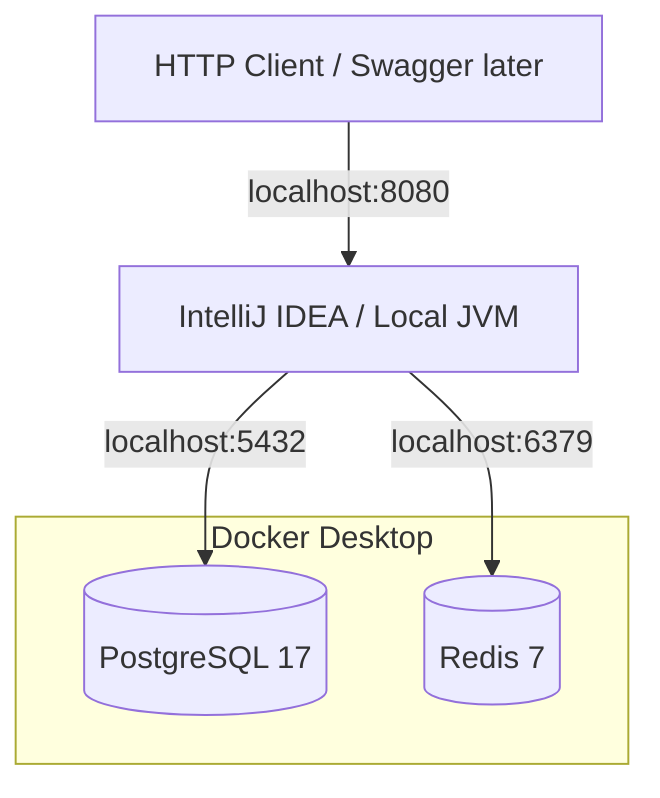

# Local Deployment Diagram

The Spring Boot application runs on the Windows host during development. PostgreSQL and Redis run in Docker containers. In a containerized application deployment, use Compose service DNS names (for example `postgres`) rather than `localhost`.
