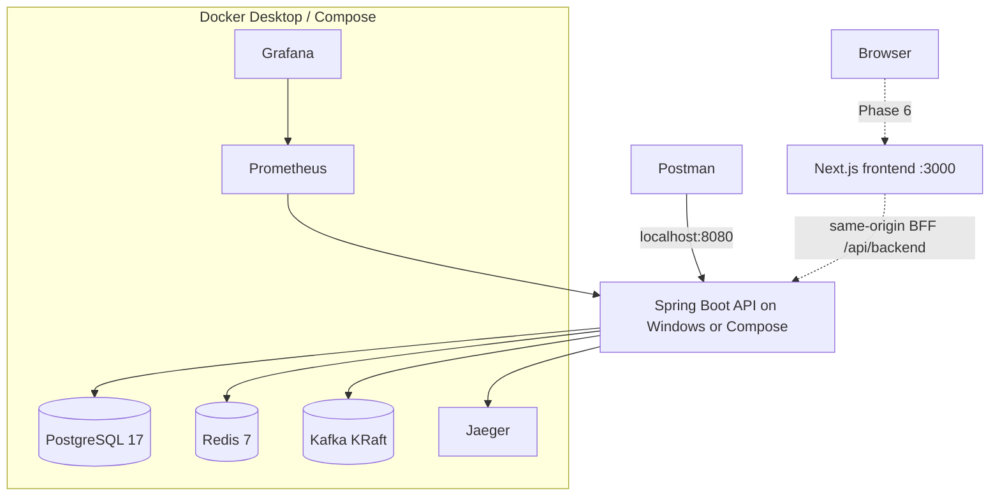
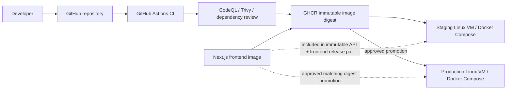

# Deployment Architecture

## Local development

For host-run API development, use `localhost` for published dependency ports and `host.docker.internal:8080` as Prometheus target. When API is containerized, use Compose service DNS names (`postgres`, `redis`, `kafka`, `jaeger`, `payment-api`) and set `PROMETHEUS_TARGET=payment-api:8080`.

## CI/CD and Linux VM deployment

Staging and production are separate environments with separate VM hosts, `.env` files, JWT keys, database credentials and persistent volumes. GitHub Environment protection gates production deployment. The workflow copies deployment code/configuration but never copies environment files or secret material. TLS termination, host firewall, private management access, backup retention and monitoring are environment responsibilities.

See the single authoritative [Phase 5 guide](../phase-5.md) for deployment, CI/CD, verification and rollback procedures.

The frontend Dockerfile was introduced in Phase 6.0; the Phase 6.1 BFF uses `API_PROXY_TARGET` for server-to-server API forwarding. Phase 6.5 now includes Compose service wiring, Nginx reverse-proxy routing, server-only `FRONTEND_SESSION_SECRET` provisioning, frontend image publishing, and paired API/frontend CI/CD deployment and rollback. The implementation is present in the repository; local Docker, staging and rollback execution are still required before deployment can be marked verified. See [Phase 6](../phase-6.md).
