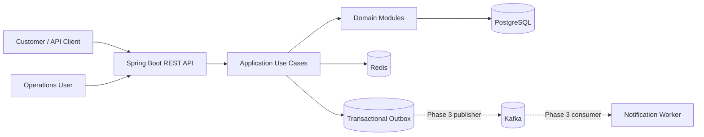

# System Architecture

## 1. Architecture style

The first release uses a **modular monolith** with package-by-feature boundaries. This is intentional: financial consistency and domain rules should be proven before introducing network boundaries and distributed transactions.

The design keeps extraction seams around payment processing, notification delivery, and reconciliation. Extraction is justified only by measured scaling, deployment, ownership, or isolation needs.

## 2. Context



## 3. Module responsibilities

| Module | Owns | Must not |
|---|---|---|
| identity | Authentication principal and authorization policies | Own account balances |
| customer | Customer profile lifecycle | Perform ledger posting |
| account | Account lifecycle, status, balance projection | Bypass ledger rules for financial mutation |
| payment | Transfer/payment orchestration and state | Directly edit another module's tables |
| ledger | Journal and entry creation, posting invariants | Delete posted financial records |
| notification | Delivery preferences and notification attempts | Change financial state |
| audit | Audit record creation/query | Become the source of business state |
| reconciliation | Compare projections against ledger | Silently repair without an auditable adjustment |
| shared | Cross-cutting primitives and error conventions | Become a dumping ground |

## 4. Dependency direction

API adapters call application use cases. Application use cases coordinate domain behavior and ports. Domain logic should not depend on Spring, JPA, Kafka, or HTTP. Infrastructure adapters implement persistence and external integration ports.

A pragmatic package shape:

```text
com.enterprise.payment
├── PaymentPlatformApplication.java
├── customer
│   ├── api
│   ├── application
│   ├── domain
│   └── infrastructure
├── account
│   ├── api
│   ├── application
│   ├── domain
│   └── infrastructure
├── payment
│   ├── api
│   ├── application
│   ├── domain
│   └── infrastructure
├── ledger
│   ├── application
│   ├── domain
│   └── infrastructure
├── identity
├── notification
├── audit
├── reconciliation
└── shared
```

## 5. Transfer consistency model

For an internal transfer, the source and destination accounts, transfer record, ledger journal/entries, and outbox event are committed in one PostgreSQL transaction.

A robust implementation sequence:

1. Validate the request and authenticated actor.
2. Claim the idempotency key in the database.
3. Lock both account rows in a deterministic order (for example, ascending UUID) to reduce deadlocks.
4. Validate account status, currency, and available balance.
5. Create transfer record.
6. Update balance projections.
7. Create a balanced ledger journal and entries.
8. Insert an outbox event.
9. Complete the idempotency record with the outcome.
10. Commit once.

If any step fails, the transaction rolls back. The implementation must handle unique-key races and retry only safe transient failures.

The account row is locked in deterministic order for every transfer to avoid the common A-to-B versus B-to-A deadlock pattern. The database remains the concurrency authority; Redis locks are not used to protect money.

## 6. Ledger model

A journal contains entries. For each posted journal and currency:

`SUM(DEBIT.amount) = SUM(CREDIT.amount)`

A row-level SQL `CHECK` cannot enforce a sum across multiple rows. The posting use case validates the journal before marking it POSTED. A later migration can add a deferred constraint trigger if the additional database enforcement is warranted.

Ledger entries are append-only. Corrections use compensating journals. Application database roles should not have update/delete permissions on posted ledger rows in a hardened deployment.

## 7. Idempotency

Idempotency key uniqueness is scoped by operation/client context. Store a canonical request hash with the key. A repeated key with the same hash returns the original outcome; a different hash returns a conflict. The record and financial effect must share a transaction.

Define retention and expiry carefully. Do not delete keys while clients may legitimately retry.

## 8. Transactional outbox

The business transaction writes an outbox row in PostgreSQL. A separate publisher later reads unpublished rows, publishes to Kafka, and marks them published. Delivery is normally at-least-once; consumers must be idempotent. Do not claim exactly-once business processing solely because Kafka producer idempotence is enabled.

## 9. Data ownership

PostgreSQL is the system of record. Redis is for non-authoritative caching, rate limiting, and short-lived coordination only. A cache outage must not create or lose a financial posting.

## 10. Security baseline

- Authenticate callers; authorize access to every customer/account resource.
- Derive customer identity from the authenticated principal, never from a trusted-looking request field.
- Validate amounts, currency, status transitions, and payload sizes.
- Use TLS outside local development.
- Store secrets in environment/secret management, never in source control.
- Redact credentials and sensitive data from logs.
- Audit privileged operations.
- Apply least-privilege database and service identities.

## 11. Failure handling

| Failure | Expected behavior |
|---|---|
| Database unavailable before commit | Fail request; no financial state committed |
| Application crashes before commit | PostgreSQL rolls back open transaction |
| Client times out after commit | Retry with same idempotency key returns original result |
| Redis unavailable | Core transfer remains correct; cache-dependent features degrade |
| Kafka unavailable | Outbox remains durable; publisher retries later |
| Consumer receives duplicate | Consumer deduplicates by event ID |
| Deadlock | One transaction aborts; bounded retry of safe operation |

## 12. Deployment evolution

Phase 0–2: one Spring Boot deployment, PostgreSQL, Redis.

Phase 3: add outbox publisher and Kafka consumer, initially within the same deployable or as a worker process.

Later: extract services only with explicit ownership, API/event contracts, independent data ownership, operational monitoring, and a documented consistency model.

## Phase 4 identity/security architecture update

Phase 4 adds an identity/authentication layer within the existing Payment API (not a separate API gateway): credentials are hashed, access tokens are RSA-signed JWTs, and refresh tokens are rotated/revoked. Spring Security applies role-based route policies (CUSTOMER, OPERATIONS, ADMIN); customer ownership checks are intended to constrain customer-facing resource access. The V4 database migration supports identity and refresh-token persistence. See [Phase 4 design](../phase-4.md), [API specification](../api/api-specification.md), and phase-specific verification documents. RSA private keys must be supplied securely at runtime and must not be committed or embedded in the executable JAR.

## Phase 4.2–4.6: audit, reconciliation, and operational resilience

- Audit records are written into the existing `audit_logs` table for identity lifecycle actions and successful transfer creation; the audit API is read-only and restricted to OPERATIONS/ADMIN.
- Reconciliation scans account cached balances against ledger entry net balances, journal debit/credit totals, and transfer amounts against linked ledger entries. Runs and discrepancy evidence persist in `reconciliation_runs` and `reconciliation_discrepancies`. It never auto-corrects financial state.
- Data-source timeouts are bounded for PostgreSQL/Hikari and Redis; Kafka producer retries/idempotence and listener retry + DLT recovery are configured. Actuator readiness includes DB, Redis, Kafka, and readiness state; liveness is process-oriented.
- Outbox claiming uses PostgreSQL `FOR UPDATE SKIP LOCKED`, lease expiry, and a per-claim lease token. A stale publisher cannot mark an event published/failed after another worker has reclaimed it (fencing). Attempts use bounded exponential retry; terminal events become DEAD and can be replayed by operations.
- Phase 4.6 includes security/integration/regression verification instructions and Postman coverage. A local classpath RSA key pair is provided for developer convenience only; production private keys must be externalized/managed by KMS or a secret store.
