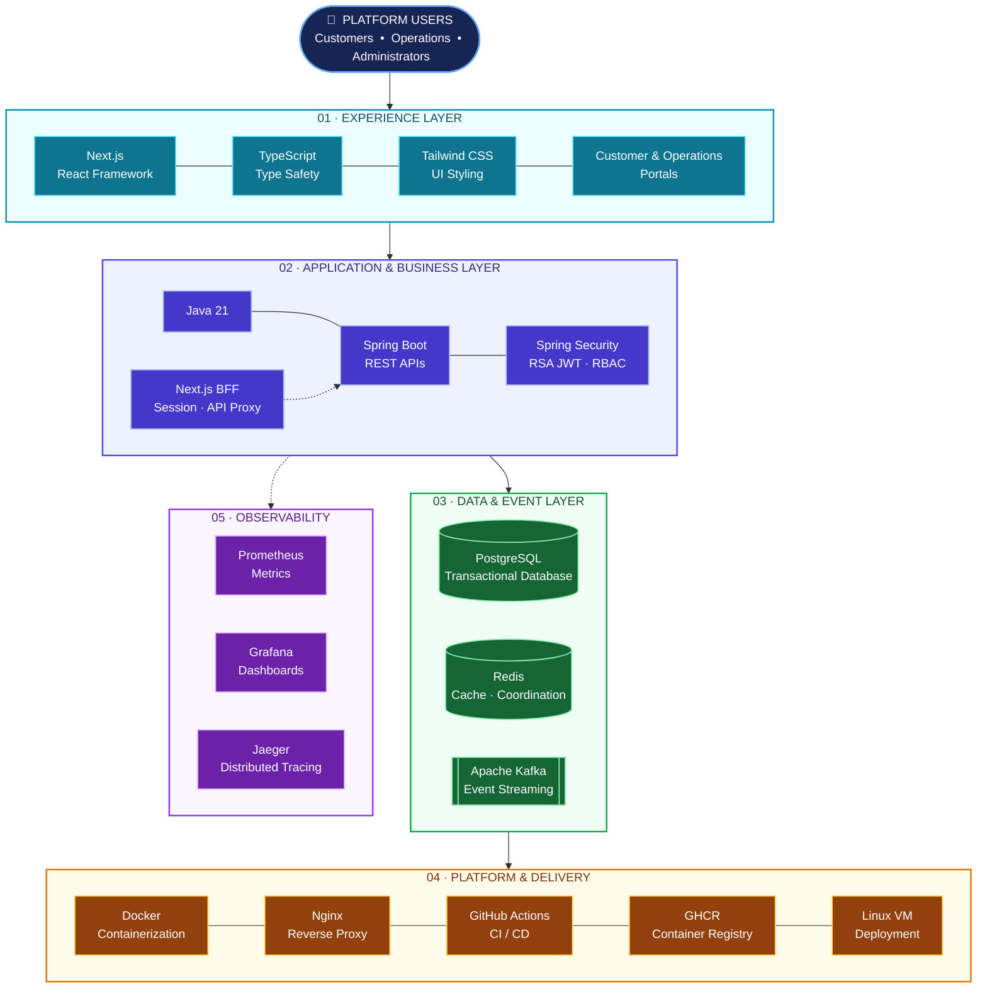
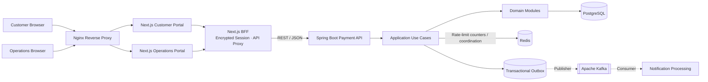

# System Architecture

## 1. Architecture style

The first release uses a **modular monolith** with package-by-feature boundaries. This is intentional: financial consistency and domain rules should be proven before introducing network boundaries and distributed transactions.

The design keeps extraction seams around payment processing, notification delivery, and reconciliation. Extraction is justified only by measured scaling, deployment, ownership, or isolation needs.

## 2. Context

The platform combines a browser-based banking experience, a Spring Boot payment application, transactional and messaging infrastructure, and an automated deployment/observability platform. This technology stack diagram gives the context at a glance.



### Context by technology layer

| Layer | Responsibility | Main technologies |
|---|---|---|
| **01 · Experience** | Delivers customer and operations web experiences. | Next.js, TypeScript, Tailwind CSS |
| **02 · Application & Business** | Implements secured APIs and banking/payment business capabilities. | Java 21, Spring Boot, Spring Security, RSA-signed JWT, Next.js BFF |
| **03 · Data & Events** | Persists financial records and supports coordination and asynchronous integration. | PostgreSQL, Redis, Apache Kafka |
| **04 · Platform & Delivery** | Packages, routes, publishes and deploys the application. | Docker, Nginx, GitHub Actions, GHCR, Linux VM |
| **05 · Observability** | Collects metrics and distributed traces and presents operational dashboards. | Prometheus, Grafana, Jaeger |

The technology stack diagram is a logical grouping, not a deployment topology. Its arrows indicate broad architectural relationships; consult the runtime context and deployment documentation for component interactions and hosting details.

## 3. Runtime context and interaction

This view focuses on the main runtime boundaries and request/event paths. Browser traffic enters through Nginx, reaches the appropriate Next.js portal, and uses the same-origin Backend-for-Frontend (BFF) to call the Spring Boot API.



The BFF keeps access and refresh tokens on the server side in the encrypted HttpOnly session cookie. Spring Security remains the authoritative backend authentication and authorization boundary. PostgreSQL owns financial state; Redis is non-authoritative; Kafka carries asynchronous events published through the transactional outbox.

## 4. Module responsibilities

| Module | Owns | Must not |
|---|---|---|
| identity | Authentication principal and authorization policies | Own account balances |
| customer | Customer profile lifecycle | Perform ledger posting |
| account | Account lifecycle, status, balance projection | Bypass ledger rules for financial mutation |
| payment | Transfer/payment orchestration and state | Directly edit another module's tables |
| ledger | Journal and entry creation, posting invariants | Delete posted financial records |
| notification | Delivery preferences and notification attempts | Change financial state |
| audit | Audit record creation/query | Become the source of business state |
| reconciliation | Compare projections against ledger | Silently repair without an auditable adjustment |
| shared | Cross-cutting primitives and error conventions | Become a dumping ground |

## 5. Dependency direction

API adapters call application use cases. Application use cases coordinate domain behavior and ports. Domain logic should not depend on Spring, JPA, Kafka, or HTTP. Infrastructure adapters implement persistence and external integration ports.

A pragmatic package shape:

```text
com.enterprise.payment
├── PaymentPlatformApplication.java
├── customer
│   ├── api
│   ├── application
│   ├── domain
│   └── infrastructure
├── account
│   ├── api
│   ├── application
│   ├── domain
│   └── infrastructure
├── payment
│   ├── api
│   ├── application
│   ├── domain
│   └── infrastructure
├── ledger
│   ├── application
│   ├── domain
│   └── infrastructure
├── identity
├── notification
├── audit
├── reconciliation
└── shared
```

## 6. Transfer consistency model

For an internal transfer, the source and destination accounts, transfer record, ledger journal/entries, and outbox event are committed in one PostgreSQL transaction.

A robust implementation sequence:

1. Validate the request and authenticated actor.
2. Claim the idempotency key in the database.
3. Lock both account rows in a deterministic order (for example, ascending UUID) to reduce deadlocks.
4. Validate account status, currency, and available balance.
5. Create transfer record.
6. Update balance projections.
7. Create a balanced ledger journal and entries.
8. Insert an outbox event.
9. Complete the idempotency record with the outcome.
10. Commit once.

If any step fails, the transaction rolls back. The implementation must handle unique-key races and retry only safe transient failures.

The account row is locked in deterministic order for every transfer to avoid the common A-to-B versus B-to-A deadlock pattern. The database remains the concurrency authority; Redis locks are not used to protect money.

## 7. Ledger model

A journal contains entries. For each posted journal and currency:

`SUM(DEBIT.amount) = SUM(CREDIT.amount)`

A row-level SQL `CHECK` cannot enforce a sum across multiple rows. The posting use case validates the journal before marking it POSTED. A later migration can add a deferred constraint trigger if the additional database enforcement is warranted.

Ledger entries are append-only. Corrections use compensating journals. Application database roles should not have update/delete permissions on posted ledger rows in a hardened deployment.

## 8. Idempotency

Idempotency key uniqueness is scoped by operation/client context. Store a canonical request hash with the key. A repeated key with the same hash returns the original outcome; a different hash returns a conflict. The record and financial effect must share a transaction.

Define retention and expiry carefully. Do not delete keys while clients may legitimately retry.

## 9. Transactional outbox

The business transaction writes an outbox row in PostgreSQL. A separate publisher later reads unpublished rows, publishes to Kafka, and marks them published. Delivery is normally at-least-once; consumers must be idempotent. Do not claim exactly-once business processing solely because Kafka producer idempotence is enabled.

## 10. Data ownership

PostgreSQL is the system of record. Redis stores atomic, expiring API rate-limit counters (Phase 4.7). It is non-authoritative and is never used for balances, ledger posting, transfer locking or idempotency correctness. A Redis outage follows the configured fail-open/fail-closed rate-limiter policy and must not create or lose a financial posting.

## 11. Security baseline

- Authenticate callers; authorize access to every customer/account resource.
- Derive customer identity from the authenticated principal, never from a trusted-looking request field.
- Validate amounts, currency, status transitions, and payload sizes.
- Use TLS outside local development.
- Store secrets in environment/secret management, never in source control.
- Redact credentials and sensitive data from logs.
- Audit privileged operations.
- Apply least-privilege database and service identities.

## 12. Failure handling

| Failure | Expected behavior |
|---|---|
| Database unavailable before commit | Fail request; no financial state committed |
| Application crashes before commit | PostgreSQL rolls back open transaction |
| Client times out after commit | Retry with same idempotency key returns original result |
| Redis unavailable | Core transfer correctness remains PostgreSQL-backed; rate limiting follows configured fail-open/fail-closed policy |
| Kafka unavailable | Outbox remains durable; publisher retries later |
| Consumer receives duplicate | Consumer deduplicates by event ID |
| Deadlock | One transaction aborts; bounded retry of safe operation |

## 13. Deployment evolution

Phase 0–2: one Spring Boot deployment, PostgreSQL, Redis.

Phase 3: add outbox publisher and Kafka consumer, initially within the same deployable or as a worker process.

Later: extract services only with explicit ownership, API/event contracts, independent data ownership, operational monitoring, and a documented consistency model.

## Phase 4 identity/security architecture update

Phase 4 adds an identity/authentication layer within the existing Payment API (not a separate API gateway): credentials are hashed, access tokens are RSA-signed JWTs, and refresh tokens are rotated/revoked. Spring Security applies role-based route policies (CUSTOMER, OPERATIONS, ADMIN); customer ownership checks are intended to constrain customer-facing resource access. The V4 database migration supports identity and refresh-token persistence. See [Phase 4 design](../phase-4.md), [API specification](../api/api-specification.md), and phase-specific verification documents. RSA private keys must be supplied securely at runtime and must not be committed or embedded in the executable JAR.

## Phase 4.2–4.6: audit, reconciliation, and operational resilience

- Audit records are written into the existing `audit_logs` table for identity lifecycle actions and successful transfer creation; the audit API is read-only and restricted to OPERATIONS/ADMIN.
- Reconciliation scans account cached balances against ledger entry net balances, journal debit/credit totals, and transfer amounts against linked ledger entries. Runs and discrepancy evidence persist in `reconciliation_runs` and `reconciliation_discrepancies`. It never auto-corrects financial state.
- Data-source timeouts are bounded for PostgreSQL/Hikari and Redis; Kafka producer retries/idempotence and listener retry + DLT recovery are configured. Actuator readiness includes DB, Redis, Kafka, and readiness state; liveness is process-oriented.
- Outbox claiming uses PostgreSQL `FOR UPDATE SKIP LOCKED`, lease expiry, and a per-claim lease token. A stale publisher cannot mark an event published/failed after another worker has reclaimed it (fencing). Attempts use bounded exponential retry; terminal events become DEAD and can be replayed by operations.
- Phase 4.6 includes security/integration/regression verification instructions and Postman coverage. A local classpath RSA key pair is provided for developer convenience only; production private keys must be externalized/managed by KMS or a secret store.


## Phase 4.7 rate limiting

The Spring Security filter applies per-IP login/registration limits and per-customer transfer/general API limits using Redis atomic fixed-window counters. See [Phase 4.7](../phase-4.md).


## Phase 5 delivery and observability

Phase 5.1 adds Micrometer/Actuator metrics, Prometheus/Grafana, OpenTelemetry/Jaeger tracing, structured JSON logs, correlation IDs and outbox trace-context persistence (Flyway V7). These are diagnostic capabilities; PostgreSQL remains the financial system of record and observability export is not part of the payment transaction commit.

Phase 5.2 adds native Windows k6 workloads, PostgreSQL integrity/performance SQL, JVM diagnostics and report templates. Transfer load requires dedicated funded test accounts whose account projections reconcile with ledger entries.

Phase 5.3 packages the API for Docker Compose deployment with externalized JWT secrets, service-DNS networking, persistent volumes, health checks and backup/restore tooling. Phase 5.3 verification has been completed by the project owner.

Phase 5.4 adds GitHub Actions CI/security gates, immutable GHCR image publishing and controlled deployment to separate Linux staging/production VMs using Docker Compose. Production release requires GitHub Environment approval. The project owner has announced Phase 5 verification complete; see the [single Phase 5 source of truth](../phase-5.md). See the [single Phase 5 source of truth](../phase-5.md).


## Phase 6 frontend boundary

The Next.js application is a separate presentation layer with Customer and Operations workspaces. Browser requests use a same-origin Next.js BFF; the BFF forwards authenticated API calls to Spring Boot and keeps JWT access/refresh tokens server-side in an AES-256-GCM encrypted HttpOnly session cookie. The frontend must not own financial rules, balance calculations, ledger writes, transfer idempotency, reconciliation or authorization decisions. Spring Security and backend ownership checks remain authoritative.

Phase 6.0 establishes the portal foundation and typed API contracts. Phase 6.1 adds login, refresh-token rotation, logout, encrypted server-side sessions and role-aware route protection. Phase 6.2 delivers customer accounts, balances, transfers, activity and notifications. Phase 6.3 delivers the Operations/Admin Portal and privileged operational workflows. Phase 6.4 provides the frontend unit, integration, E2E, security, accessibility and responsive verification foundation. Phase 6.5 adds frontend containerization, Nginx reverse proxy, GHCR publishing and deployment/rollback workflows. All Phase 6.0–6.5 milestones are user-verified complete; see the [Phase 6 implementation guide](../phase-6.md).
