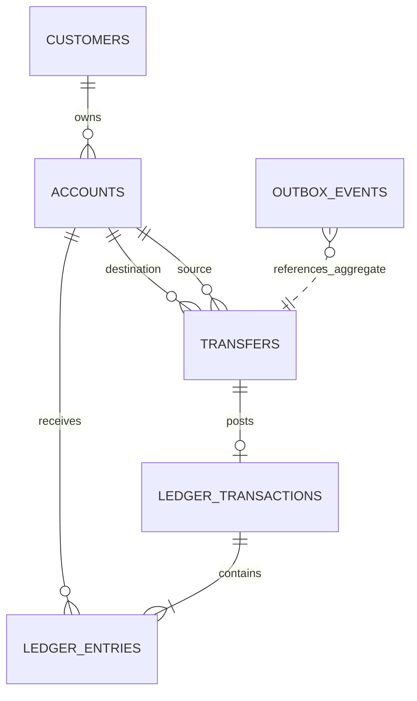

# Database Design — Phase 0

## Conventions

- Primary keys: UUID.
- Timestamps: `TIMESTAMPTZ`; application uses UTC `Instant`.
- Money: `NUMERIC(19,4)`; never floating point.
- Currency: uppercase ISO-style three-character code.
- Schema changes: Flyway only; Hibernate uses `ddl-auto=validate`.
- Posted ledger rows are append-only by application design.

## Entity relationships

## Tables

| Table | Purpose | Important constraints |
|---|---|---|
| customers | Customer profile | Unique email, status check |
| accounts | Account and balance projection | Unique account number, nonnegative balance, version |
| transfers | Transfer lifecycle | Positive amount, distinct accounts, valid status |
| ledger_transactions | Journal header | Transfer uniqueness, status/type checks |
| ledger_entries | Debit/credit lines | Positive amount, entry type, account FK |
| idempotency_records | Request deduplication | Unique scope + key, request hash |
| outbox_events | Durable event intent | Pending-event index |
| audit_logs | Audit trail | Resource/actor time indexes |

## Balance semantics

`accounts.balance` is a current balance projection maintained in the same transaction as ledger posting. It is not an independent source of truth. Reconciliation derives the expected balance from ledger entries according to the account's debit/credit convention.

For this MVP, customer deposit accounts are treated as liability accounts from the bank's perspective. Customer credits increase the customer's balance; customer debits decrease it. The ledger entry direction and balance projection mapping must be implemented consistently and documented in the ledger domain.

## Important integrity gap to close in implementation

The schema has row-level checks, but it does not yet enforce that each `POSTED` journal balances across multiple rows. The ledger posting use case must validate:
- At least two entries.
- Positive amounts.
- One currency per journal for MVP.
- Total debit equals total credit.
- Journal state changes to POSTED only after validation.

Consider a deferred constraint trigger in a later migration to add database-level defense in depth.

## Migration

`src/main/resources/db/migration/V1__create_payment_platform_schema.sql` creates the initial schema. Treat it as immutable after it has been applied in a shared environment. Add subsequent changes as V2, V3, and so on.
