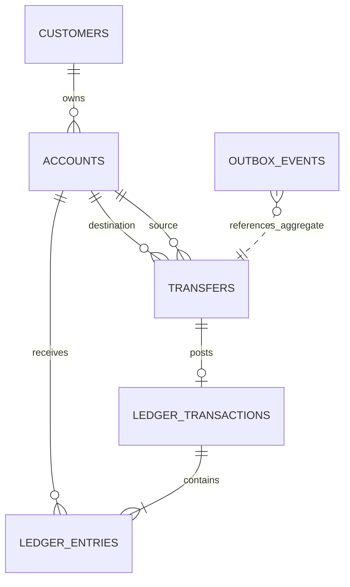

# Database Design — Current Schema and Financial Invariants

## Conventions

- Primary keys: UUID.
- Timestamps: `TIMESTAMPTZ`; application uses UTC `Instant`.
- Money: `NUMERIC(19,4)`; never floating point.
- Currency: uppercase ISO-style three-character code.
- Schema changes: Flyway only; Hibernate uses `ddl-auto=validate`.
- Posted ledger rows are append-only by application design.

## Entity relationships

## Tables

| Table | Purpose | Important constraints |
|---|---|---|
| customers | Customer profile | Unique email, status check |
| accounts | Account and balance projection | Unique account number, nonnegative balance, version |
| transfers | Transfer lifecycle | Positive amount, distinct accounts, valid status |
| ledger_transactions | Journal header | Transfer uniqueness, status/type checks |
| ledger_entries | Debit/credit lines | Positive amount, entry type, account FK |
| idempotency_records | Request deduplication | Unique scope + key, request hash |
| outbox_events | Durable event intent | Pending-event index |
| audit_logs | Audit trail | Resource/actor time indexes |

## Balance semantics

`accounts.balance` is a current balance projection maintained in the same transaction as ledger posting. It is not an independent source of truth. Reconciliation derives the expected balance from ledger entries according to the account's debit/credit convention.

For this MVP, customer deposit accounts are treated as liability accounts from the bank's perspective. Customer credits increase the customer's balance; customer debits decrease it. The ledger entry direction and balance projection mapping must be implemented consistently and documented in the ledger domain.

## Journal balance invariant

The schema has row-level checks, while cross-row journal balance is enforced by the ledger posting use case. The use case validates:
- At least two entries.
- Positive amounts.
- One currency per journal for MVP.
- Total debit equals total credit.
- Journal state changes to POSTED only after validation.

A deferred database constraint trigger remains a possible future defense-in-depth enhancement; it is not claimed to exist in the current migrations.

## Migration

`src/main/resources/db/migration/V1__create_payment_platform_schema.sql` creates the initial schema. Treat it as immutable after it has been applied in a shared environment. The current baseline contains append-only migrations V1–V7. V7 adds correlation and W3C trace context to outbox records for asynchronous observability. Add subsequent changes as V8 and onward.

## Phase 5 database operations

PostgreSQL remains the financial system of record across local Compose and Linux VM deployment. Named Compose volumes preserve database state across container recreation. Do not use `docker compose down -v` as a routine troubleshooting command. Phase 5.3/5.4 backup scripts produce PostgreSQL custom-format dumps; validate archive readability and rehearse restores into a separate database. A readable archive is not proof of a successful recovery. Validate Flyway history, account/ledger balance consistency, journal debit/credit equality, transfer/idempotency records and outbox state after restore.

The Phase 5.4 deployment baseline currently uses the Compose-created PostgreSQL account for both application connectivity and migrations. Before real production financial workloads, split migration/schema-owner privileges from the runtime application's least-privilege database role and review grants. See the [Phase 5 source of truth](../phase-5.md).
