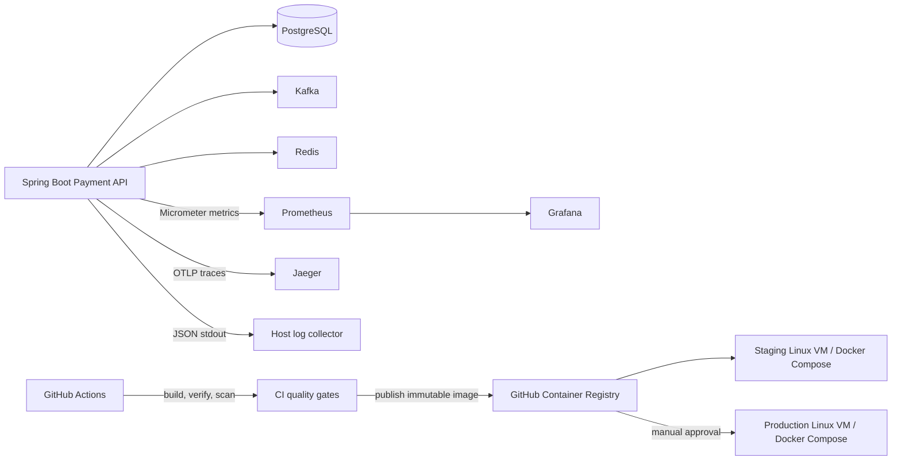

# Phase 5 — Observability, Performance, Deployment and CI/CD

**Status as of 2026-11-12**

- Phase 5.1 — Observability: implementation completed; user reported completion.
- Phase 5.2 — Performance and load testing: implementation completed; user reported completion. Performance figures must come from actual k6 result artifacts, not this document.
- Phase 5.3 — Containerization and deployment readiness: user completed verification.
- Phase 5.4 — CI/CD and production readiness: implementation baseline included; GitHub Actions execution and Linux VM deployments are pending user-side verification.

This file is the **single source of truth for Phase 5**. Phase 5 scope, implementation, configuration, execution, verification, operational limits and rollback guidance belong here. `README.md` and other documentation should link here rather than maintaining separate Phase 5 runbooks.

## 1. Phase 5 goals and boundaries

Phase 5 extends the Java 21 / Spring Boot 4.0.0 payment platform with observability, repeatable performance testing, container deployment, and controlled CI/CD. PostgreSQL remains the financial system of record; Kafka is used for asynchronous event integration; Redis is used for rate limiting and ephemeral coordination. No phase introduces a distributed microservice architecture or changes the financial source of truth.

Phase 5.3 establishes deployment readiness, not production certification. Phase 5.4 adds an automated delivery baseline, but a successful workflow does not certify a regulated payment system. TLS ingress, host hardening, database privilege separation, secret management, backup retention, disaster recovery, security assessment and operational SLOs still require environment-specific work.

## 2. Phase 5 architecture



- Local development uses Windows 11, IntelliJ IDEA, PowerShell and Docker Desktop. The API may run on the host or as the opt-in Compose `payment-api` service.
- Container-to-container traffic uses Compose service DNS names (`postgres`, `redis`, `kafka`, `jaeger`, `payment-api`), never `localhost`.
- Staging and production use separate Linux VMs, `.env` files, JWT key pairs, database volumes and credentials.
- GHCR image digests identify the exact artifact promoted from staging to production. Mutable `latest` tags are not deployment identifiers.

## 3. Phase 5.1 — Observability

### 3.1 Implementation

The observability implementation preserves the Phase 4.7 application behavior and adds Flyway V7 for correlation/trace context on outbox events. V1–V6 are retained. The financial transaction boundary and Kafka event JSON contract are unchanged.

- Metrics: Spring Boot Actuator, Micrometer and Prometheus registry. Grafana queries Prometheus.
- Tracing: Micrometer Tracing with OpenTelemetry/OTLP export to Jaeger. Kafka template/listener observations are enabled.
- Logging: structured Logstash JSON console output. Correlation ID is added to MDC and returned as `X-Correlation-ID`.
- Async trace continuity: V7 persists `correlation_id`, W3C `traceparent` and `tracestate` on outbox records. The publisher restores the parent context before publishing.
- Financial correctness: observability export is diagnostic and must not participate in the payment commit decision.

### 3.2 Security and configuration

`/actuator/prometheus` is protected by a dedicated HTTP Basic security chain with `ROLE_METRICS`. Prometheus reads its password from `.secrets/metrics-password`; the API and Prometheus username/password must match. `.env`, `.secrets/` and generated `observability/prometheus/prometheus.yml` must not be committed. Grafana, Prometheus and Jaeger interfaces bind to loopback in the supplied Compose configuration. Change local Grafana credentials before use.

For host-run API development, Prometheus target is `host.docker.internal:8080`. For a containerized API, set `PROMETHEUS_TARGET=payment-api:8080` and regenerate Prometheus configuration. The Linux VM preparation script defaults to the container target.

### 3.3 Local startup (Windows PowerShell)

```powershell
# Review .env and set unique local metrics/Grafana credentials first.
.\scripts\setup-observability.ps1
docker compose config --quiet
docker compose up -d

# To run the API on the Windows host with .env values loaded:
.\scripts\run-local-api.ps1
```

If starting from IntelliJ, set the same environment values in the Run Configuration. Do not maintain a second source of credentials. The setup script writes the generated Prometheus username and a password file without printing the secret.

### 3.4 Components and local endpoints

| Component | Local endpoint | Purpose |
|---|---|---|
| Payment API | `http://localhost:8080` | API and Actuator |
| Kafka UI | `http://localhost:8081` | Kafka inspection |
| Prometheus | `http://localhost:9090` | Metrics scrape/query |
| Grafana | `http://localhost:3000` | Dashboards |
| Jaeger | `http://localhost:16686` | Distributed traces |
| Jaeger OTLP HTTP | `http://localhost:4318` | Trace ingestion |

### 3.5 Application metrics

The implementation includes standard HTTP, JVM, process, HikariCP and supported Kafka client metrics, plus bounded-cardinality application meters including:

- `payment.transfers.completed` and `payment.transfers.duration` (currency only).
- `payment.outbox.published`, `payment.outbox.failed`, `payment.outbox.pending` and `payment.outbox.oldest.pending.age`.
- `payment.notifications.processed`.
- `payment.rate_limit.rejected` and `payment.rate_limit.degraded` (bounded policy/bucket values).
- `payment.reconciliation.runs`, `payment.reconciliation.duration` and `payment.reconciliation.discrepancies`.

Never add customer IDs, account IDs, transfer IDs, emails, idempotency keys or other unbounded values as metric tags. The pending/oldest-age gauges are periodically refreshed and do not execute database queries on every scrape. Kafka metric names vary by client/runtime; inspect live `/actuator/prometheus` output before relying on a panel.

Five provisioned Grafana dashboards cover Application Overview, JVM and Database, Kafka and Notifications, Outbox Operations, and Payment Performance.

### 3.6 Observability verification

1. Run `mvn clean verify` (or the current project verification command) and record the result.
2. Start dependencies and API.
3. `curl.exe -i http://localhost:8080/actuator/prometheus` without credentials should return 401.
4. Authenticated metrics request should return 200 and Prometheus text exposition.
5. In Prometheus → Status → Targets, verify `payment-api` is `UP`.
6. Sign in to Grafana and verify provisioned Prometheus/Jaeger data sources and dashboards.
7. Exercise an API request and transfer/outbox path; search Jaeger for `enterprise-payment-platform`.
8. Send `X-Correlation-ID` on an authenticated request and verify it is echoed; otherwise a UUID is generated.
9. Inspect recent outbox rows for `correlation_id`, `traceparent` and `tracestate`.
10. Stop Prometheus/Grafana/Jaeger while leaving payment dependencies and API running; payment APIs should remain available.

Example metrics verification:

```powershell
curl.exe -i http://localhost:8080/actuator/prometheus
curl.exe -u "$env:METRICS_USERNAME`:$env:METRICS_PASSWORD" http://localhost:8080/actuator/prometheus
```

Do not log tokens, passwords, private keys, full payment payloads or personal data. Jaeger all-in-one uses development-oriented in-memory storage; this is not a durable production trace backend. OTLP export is diagnostic and must not roll back transfers. Lower tracing sampling from the local default for production.

### 3.7 Phase 5.1 corrective notes retained

Spring Boot 4 tracing uses modular Micrometer Tracing/OpenTelemetry auto-configuration in addition to the bridge and OTLP exporter. The project includes `spring-boot-micrometer-tracing-opentelemetry` and `spring-boot-opentelemetry`; the OTLP trace endpoint property is `management.opentelemetry.tracing.export.otlp.endpoint`. Notification processing records its metric after commit when transaction synchronization is active and records immediately for direct non-transactional unit-test invocation. Existing source/destination notification behavior is unchanged.

Focused test command: `mvn "-Dtest=NotificationServiceTest" test`; full suite: `mvn clean test`.

## 4. Phase 5.2 — Performance and load testing

### 4.1 Purpose and tooling

Phase 5.2 supplies repeatable performance and load-test assets. k6 is installed natively on Windows; it is not run inside Docker. Docker Compose remains responsible for platform infrastructure and observability. The project includes smoke, API baseline, transfer load, idempotency concurrency and Redis rate-limit workloads; PostgreSQL diagnostics; transfer-integrity SQL; JVM Flight Recorder capture; and a performance report template.

Install k6 on Windows:

```powershell
winget install --id GrafanaLabs.k6 -e
# Reopen PowerShell, then verify:
k6 version
```

### 4.2 Workload sequence

Run in this order, starting with a low-impact smoke test:

```powershell
.\scripts\run-k6-smoke.ps1
.\scripts\run-k6-api-baseline.ps1
.\scripts\run-k6-idempotency.ps1
.\scripts\run-k6-redis-rate-limit.ps1
.\scripts\run-k6-transfer-load.ps1
```

Use each script's `-Help`/parameters or inspect its contents before execution; provide dedicated test-only credentials and account IDs through environment variables. Capture the output and JSON summary under `load-tests/results/`. Never run destructive or high-concurrency workloads against production data.

### 4.3 Financial data prerequisites

Transfer load tests require dedicated, funded test accounts whose account balance projections reconcile with ledger entries and whose currencies match. The application has no deposit/funding endpoint. Do not fabricate test balances by updating only the `accounts` table. Seed through a documented, balanced test fixture/approved funding workflow or use a dedicated test database.

### 4.4 Measurements and diagnostics

Capture request throughput, error rate, p50/p95/p99 latency, JVM heap/GC, thread state, Hikari pool utilization, PostgreSQL locks/queries, Kafka consumer lag, outbox pending age, Redis rate-limit behavior and financial integrity. Use `load-tests/sql/performance-diagnostics.sql`, `load-tests/sql/reconciliation-precheck.sql` and `load-tests/sql/verify-transfer-integrity.sql` before/after relevant workloads. Use `scripts/capture-jvm-diagnostics.ps1` for JVM Flight Recorder/diagnostic capture.

Thresholds must be defined before a test run and compared against actual measurements. Do not claim a performance target passed from a script's exit code alone; review HTTP status/body, checks, SQL invariants and captured result artifacts. A prior idempotency run reported 20 iterations, 22 requests, 12 failures and all 20 checks failed while p95 remained under its latency threshold. Treat that as a failed test run, not a passing performance result. The user later reported Phase 5.2 completed; this document does not invent benchmark figures.

### 4.5 Performance report record

For each representative run, record:

| Field | Evidence |
|---|---|
| Commit SHA / application version | |
| Host CPU/RAM/OS and Docker versions | |
| Database size and test-account setup | |
| k6 version and exact command/options | |
| Virtual users, duration and request count | |
| Throughput and p50/p95/p99 | |
| HTTP failure rate and failed checks | |
| JVM/GC/thread/Hikari observations | |
| PostgreSQL diagnostics and lock contention | |
| Kafka lag/outbox age/Redis metrics | |
| Ledger/reconciliation integrity result | |
| Bottlenecks and recommended changes | |

Store selected JSON/JFR/thread/heap artifacts outside Git or attach them to a report. Do not commit credentials, access tokens, personal data or generated heap dumps. A performance test passes only when latency/error criteria and financial correctness checks both pass.

## 5. Phase 5.3 — Containerization and deployment readiness

### 5.1 Scope and status

Phase 5.3 packages the existing Spring Boot application and dependencies into a repeatable Docker Compose deployment. The user has completed and verified Phase 5.3. This is deployment readiness, not production certification, high availability, disaster recovery certification, Kubernetes readiness or compliance approval.

### 5.2 Implemented components

- Multi-stage Java 21 Docker build and JRE runtime, running as a non-root application user.
- `.dockerignore` excludes local credentials, generated files, documentation and development JWT PEM resources from the build context.
- Opt-in Compose `deployment` profile for `payment-api`; ordinary `docker compose up -d` remains the infra-only workflow.
- Docker profile and externalized datasource, Redis, Kafka, OTLP and JWT secret configuration.
- File-backed Compose JWT secrets under `.secrets/`; unique keys must be provisioned per environment.
- Flyway applies new migrations at startup; Hibernate uses `ddl-auto: validate`. Never edit already-applied V1–V7 migrations.
- Named persistent volumes for PostgreSQL, Kafka, Redis, Prometheus and Grafana.
- Dependency health ordering, container health checks, restart policy, graceful shutdown and deployment verification.
- Windows PowerShell scripts for local deploy, verification, PostgreSQL backup and restore.

### 5.3 Local deployment (Windows PowerShell)

1. Copy `.env.example` to `.env`; replace placeholders with local values. Keep PostgreSQL values consistent with the existing initialized database role. Updating `POSTGRES_PASSWORD` in `.env` does not change a password in an existing persistent PostgreSQL volume.
2. Prepare local deployment JWT keys using `scripts/prepare-deployment-secrets.ps1` only for local development. Do not use these keys in staging or production.
3. Run `scripts/setup-observability.ps1`.
4. Validate Compose: `docker compose config --quiet`.
5. Start local deployment: `scripts/deploy-local-stack.ps1`.
6. Verify: `scripts/verify-deployment.ps1`.
7. Inspect `docker compose --profile deployment ps` and `docker compose logs --tail=200 payment-api`.

The API container uses Compose DNS (`postgres`, `redis`, `kafka`, `jaeger`), not `localhost`. A host-run API uses `localhost` for exposed local ports.

### 5.4 Backup and restore

The Windows scripts `scripts/backup-postgres.ps1` and `scripts/restore-postgres.ps1` use PostgreSQL custom-format dumps. Restore into a separate verification database and validate Flyway history, account/ledger balances, balanced journals, transfer/idempotency state and outbox state. Never use `docker compose down -v` as a troubleshooting step; it removes persistent volumes. Keep backup copies protected and encrypted.

### 5.5 Phase 5.3 verification record

The user reports Phase 5.3 verification complete. The original per-check record should be retained by the operator as evidence; do not infer a specific PASS for every individual item from the overall completion statement. For future environment verification, record: environment, commit/archive, Docker and Compose versions, image reference, execution date/operator, Compose syntax, image build, non-root user, dependency health, liveness/readiness, Flyway history, Postman regression, restart recovery, persistence, backup/restore and ledger reconciliation.

### 5.6 Boundaries

Kubernetes/Helm, multi-node HA, managed secrets, TLS termination, WAF, production SLO certification, formal penetration testing, multi-region disaster recovery and compliance attestations are not supplied by Phase 5.3. Phase 5.4 provides additional CI/CD baseline but does not remove these requirements.

## 6. Phase 5.4 — CI/CD and production readiness

### 6.1 Delivery architecture and status

The selected deployment target is separate Linux VMs running Docker Compose. GitHub Actions builds and verifies the code, scans source/dependencies, publishes an immutable GHCR image, deploys automatically to staging after successful publication, and provides a manually approved production workflow. The user has not yet reported running these remote workflows or deploying to the Linux VMs; those checks remain pending.

### 6.2 Repository workflows

| Workflow | Trigger | Responsibility |
|---|---|---|
| `.github/workflows/ci.yml` | PR to `main`, push to `main`, `v*` tag, manual | Java 21 Maven `clean verify`, Testcontainers tests, reports, CodeQL, dependency review on PRs, Trivy filesystem scan, Docker build |
| `.github/workflows/publish-image.yml` | Successful `CI` workflow run on push to `main` or `v*` | Build/publish multi-platform image to GHCR, generate SBOM/provenance, scan image, write immutable digest to workflow summary; successful `main` publication triggers staging |
| `.github/workflows/deploy-production.yml` | Manual workflow dispatch | Validate image digest and source SHA, require `production` Environment approval, deploy exact digest to production VM |

The CI workflow is the required gate. Configure branch protection for `Maven build and tests`, `Static analysis and dependency/secret scan`, and `CI gate`. The Docker build is also a required CI job. Use pull requests and prohibit direct pushes to protected `main`.

### 6.3 GHCR artifact identity

The publish workflow creates an OCI image for `linux/amd64` and `linux/arm64`, with BuildKit cache, provenance and SBOM metadata. It records the immutable reference `ghcr.io/<owner>/<repository>@sha256:<digest>` in the workflow summary. `latest` and branch/version tags are convenience tags only. Deploy staging and production by immutable digest. Production workflow requires both the digest and the full 40-character source commit SHA so it can check out the corresponding deployment scripts. The operator must verify that the digest/source SHA pair is the one actually staged; syntax validation alone cannot prove that association.

### 6.4 Security gates

- CodeQL Java/Kotlin static analysis.
- Dependency review on pull requests, failing high severity and above.
- Trivy filesystem scan for vulnerabilities, misconfiguration and secrets.
- Trivy image scan for critical/high OS and library vulnerabilities.
- The checked-in development JWT private-key fixture is excluded by path from Trivy filesystem scanning because it is a local test/development asset. It is not a production key and must never be deployed. Repository owners should replace/remove test fixtures before publishing a public repository and should never suppress a real credential finding.
- Actions use least-privilege workflow permissions; GHCR publish uses `GITHUB_TOKEN` with `packages: write`.

Security scan failure blocks image promotion/deployment. Findings must be triaged, fixed or explicitly risk-accepted with documented compensating controls.

### 6.5 Linux VM prerequisites

Use separate Ubuntu 24.04 LTS VMs for staging and production. A starting portfolio sizing guideline is 4 vCPU and 8 GB RAM, subject to measured load and service footprint. Install Docker Engine and Docker Compose v2 from Docker's official installation instructions. The deployment account needs Docker access; membership in the Docker group is effectively root-equivalent and must be restricted.

Required host controls:

- Static DNS and a maintained TLS reverse proxy/load balancer.
- Firewall exposes only required HTTPS ingress and tightly restricted SSH. Do not publicly expose PostgreSQL, Redis, Kafka, Prometheus, Grafana or Jaeger.
- Host patching, time synchronization, log rotation, disk/CPU/memory monitoring and alerting.
- Separate VMs, `.env`, secrets, JWT key pairs, database credentials and volumes for staging and production.
- SSH host-key verification pinned in GitHub Environment secrets. Never disable host-key checking or trust a runtime `ssh-keyscan` result without independent verification.
- For production, prefer a self-hosted runner or private overlay network rather than broadly opening SSH to GitHub-hosted runner IP ranges.

### 6.6 GitHub repository and Environment configuration

Create GitHub Environments named exactly `staging` and `production`.

Staging Environment variables:
- `STAGING_HOST` — DNS name/private overlay address.
- `STAGING_USER` — deployment account.
- `STAGING_DEPLOY_PATH` — normally `/opt/enterprise-payment-platform`.

Staging Environment secrets:
- `STAGING_SSH_PRIVATE_KEY`.
- `STAGING_SSH_KNOWN_HOSTS` — pre-verified known_hosts entry.
- `GHCR_PULL_USERNAME` and `GHCR_PULL_TOKEN` — dedicated read-only package credentials.

Production Environment variables:
- `PRODUCTION_HOST`.
- `PRODUCTION_USER`.
- `PRODUCTION_DEPLOY_PATH`.

Production Environment secrets:
- `PRODUCTION_SSH_PRIVATE_KEY`.
- `PRODUCTION_SSH_KNOWN_HOSTS`.
- `GHCR_PULL_USERNAME` and `GHCR_PULL_TOKEN`.

Configure required production reviewers and prevent self-review where supported. The GHCR VM token requires package read access only. The workflow's `GITHUB_TOKEN` publishes the package; do not give the VM a package-write token.

### 6.7 Linux VM directory and environment

The default deployment path is `/opt/enterprise-payment-platform`. The VM should contain:

```text
/opt/enterprise-payment-platform/
├── docker-compose.yml
├── .env
├── .secrets/
│   ├── jwt-private.pem
│   ├── jwt-public.pem
│   └── metrics-password
├── observability/
├── scripts/
├── backups/
└── .deployment/
```

Create `.env` separately on each VM. Minimum required values include `POSTGRES_DB`, `POSTGRES_USER`, `POSTGRES_PASSWORD`, `METRICS_USERNAME`, `METRICS_PASSWORD`, Grafana credentials, `SERVER_PORT`, `PROMETHEUS_TARGET=payment-api:8080`, and Docker profile settings. Use unique strong values. If PostgreSQL volume is already initialized, the database role password must match the `.env` password; changing the environment variable does not rotate the existing PostgreSQL role password. Never use `docker compose down -v` to resolve credential mismatch.

Provision a unique matching RSA JWT key pair per environment using an approved secure process. Do not copy `src/main/resources/keys` development keys. The runtime image uses UID/GID 10001; file-backed Compose secrets must have host ownership/modes that permit that UID to read the private key. The Prometheus password file must be readable by the Prometheus container; the supplied script uses mode 0644, which exposes that file to local VM users, so harden the VM or replace this with a restricted group-based permission arrangement before production use.

The application currently uses the Compose-created PostgreSQL account for application connectivity and migrations. Before real production financial workload, separate schema-owner/migration privileges from the runtime application's least-privilege role and review grants. This separation is not implemented by this phase baseline.

### 6.8 Staging deployment sequence

1. Open a PR and wait for all required CI checks.
2. Merge to `main`.
3. Wait for CI success and GHCR publication.
4. Trivy image scan must pass.
5. `deploy-staging` copies Compose, observability configuration and scripts to the staging VM; it does not copy `.env` or `.secrets`.
6. The VM authenticates to GHCR with package-read credentials.
7. `prepare-linux-deployment.sh` validates the VM environment, renders Prometheus configuration and creates the metrics password file.
8. `deploy-linux-vm.sh` validates Compose, starts dependencies, waits for PostgreSQL health, creates/verifies a custom-format PostgreSQL backup, pulls the immutable image digest, recreates the API and polls readiness.
9. Run Postman smoke/regression tests and financial integrity/reconciliation checks against staging.

### 6.9 Production release sequence

1. Identify the exact GHCR digest and source commit SHA from the successful staging publication/deployment record.
2. In GitHub Actions, run `Deploy Production`.
3. Enter `sha256:<64 hex characters>` and the full 40-character source commit SHA.
4. Wait for required GitHub `production` Environment approval.
5. The workflow checks out deployment scripts at the supplied source SHA, connects to the production VM using pinned SSH host keys, and deploys the supplied immutable digest.
6. Verify health/readiness, container image digest, logs, metrics, Postman smoke tests and ledger reconciliation. Record release SHA, digest, approver, backup filename, timestamps and outcome.

### 6.10 Linux scripts and operational behavior

- `scripts/prepare-linux-deployment.sh`: validates required environment values and JWT files, renders Prometheus config and prepares metrics password file.
- `scripts/backup-postgres-linux.sh`: creates a PostgreSQL custom-format backup and verifies its archive listing.
- `scripts/deploy-linux-vm.sh`: validates an immutable GHCR digest reference, starts dependencies, waits for PostgreSQL health, backs up the database, pulls the image, deploys the API and polls readiness. It records the previous image and attempts application-image rollback if readiness fails.
- `scripts/rollback-linux-vm.sh`: restores the recorded previous image and checks readiness.

The backup is stored under `backups/`; copy encrypted backups off-host and define retention. `pg_restore -l` confirms the archive is readable, not that a full restore is operationally correct. Perform restore rehearsals into a separate database and validate Flyway history, account/ledger invariants, transfers, idempotency and outbox state.

### 6.11 Rollback and database migration compatibility

Application image rollback does not reverse Flyway migrations, restore PostgreSQL data, rewind Kafka messages or reverse external side effects. Automatic rollback is therefore safe only when the previous application version remains compatible with the current schema.

Use expand/contract migrations:

1. Add nullable/backward-compatible columns, tables or indexes.
2. Deploy code compatible with old and new schema.
3. Backfill and validate data.
4. Deploy code requiring the new schema.
5. Remove obsolete schema in a later release after the rollback window.

Never edit applied migrations V1–V7. Add new forward-only migrations. For a destructive or incompatible migration, stop and create a separate approved maintenance and restore plan before deployment.

Manual VM rollback:

```bash
cd /opt/enterprise-payment-platform
./scripts/rollback-linux-vm.sh
```

Database restoration is a separate, explicitly approved disaster-recovery operation. Never overwrite the only current database copy. Restore to a separate target during rehearsal, then validate account balances against ledger-derived balances, journal debit/credit equality, transfer/idempotency state and outbox/notification processing state.

### 6.12 Phase 5.4 verification checklist

**CI and security**
- [ ] PR runs Maven `clean verify` and Testcontainers tests.
- [ ] Surefire/Failsafe reports are retained.
- [ ] CodeQL, dependency review and Trivy filesystem scan pass.
- [ ] Docker image build passes.
- [ ] Branch protection requires CI jobs.

**Image**
- [ ] GHCR publishes image only after CI success.
- [ ] Image is multi-platform and has SBOM/provenance metadata.
- [ ] Image scan passes.
- [ ] Image is referenced by immutable digest.
- [ ] Development JWT keys are absent from runtime image.
- [ ] Runtime process runs as UID/GID 10001.

**Staging**
- [ ] Staging GitHub Environment variables/secrets configured.
- [ ] SSH host key is pinned and verified.
- [ ] VM has independent `.env` and JWT secrets.
- [ ] Pre-deployment backup created and verified.
- [ ] Application readiness succeeds.
- [ ] Postman smoke/regression tests pass.
- [ ] Ledger/reconciliation integrity passes.

**Production**
- [ ] Production Environment requires reviewer approval.
- [ ] Exact digest has been tested in staging.
- [ ] Production deployment uses the same digest.
- [ ] Health, logs, metrics and smoke tests pass.
- [ ] Application rollback has been rehearsed.
- [ ] Database restore has been rehearsed separately.

## 7. Phase 5 completion and status record

| Sub-phase | Deliverable | Status | Evidence still required |
|---|---|---|---|
| 5.1 | Metrics, tracing, structured logs, correlation and dashboards | User-reported complete | Preserve actual test/monitoring evidence |
| 5.2 | k6 workloads, SQL/JVM diagnostics and performance report assets | User-reported complete | Preserve actual measurements and financial integrity results |
| 5.3 | Docker/Compose deployment readiness, secrets, health checks, backup/restore scripts | User-verified complete | Keep operator's signed verification record |
| 5.4 | GitHub Actions, security gates, GHCR, Linux VM deployment and rollback baseline | Implemented baseline; remote verification pending | CI run, image digest, staging tests, production approval/rehearsal |

Phase 5 is not fully production-verified until Phase 5.4 remote CI/CD and VM checks have actual recorded evidence.

## 8. Historical Phase 5 troubleshooting notes

- **PostgreSQL password authentication failure:** Compose maps `POSTGRES_PASSWORD` to `SPRING_DATASOURCE_PASSWORD`. PostgreSQL initialization variables do not rotate an existing role password in a persistent volume. Check `.env`, actual PostgreSQL role password and container environment. Do not use `localhost` as the datasource host inside the API container; use `postgres`. Do not delete volumes to fix credentials.
- **Dockerfile parse error:** Dockerfile line continuation is a single trailing backslash (`\`), not two literal backslashes. The next command must remain part of the same `RUN` instruction.
- **PowerShell scripts with a leading `\`:** remove any standalone backslash line; the first executable line should be a valid PowerShell statement such as `$ErrorActionPreference = "Stop"` or a `param(...)` block.
- **Prometheus target down:** use `host.docker.internal:8080` for a host-run API and `payment-api:8080` for a containerized API. Ensure credentials in API and Prometheus config match.
- **JWT secret permission errors:** the Windows `prepare-deployment-secrets.ps1` script copies local development keys without deleting existing files or changing ACLs; if a pre-existing `.secrets` file is inaccessible, repair that directory's permissions before retrying. On Linux, file-backed Compose secrets retain host file permissions. Ensure UID/GID 10001 can read the private/public key files. Do not apply Windows `icacls` instructions on Linux.
- **Kafka connectivity:** containerized API bootstrap address is `kafka:29092`; host-run API uses `localhost:9092`. Ensure the broker advertises an address resolvable from the client network.
- **Performance test checks fail:** inspect response status/body, failed checks and database integrity output. Passing latency thresholds does not mean a test passed if HTTP/check assertions or ledger invariants fail.

## 9. Related project documentation

This is the only current Phase 5 guide. Project-level overview: [`../README.md`](../README.md). Architecture: [`architecture/system-architecture.md`](architecture/system-architecture.md) and [`architecture/deployment-diagram.md`](architecture/deployment-diagram.md). Phase 4 API and verification details remain in [`phase-4.md`](phase-4.md) and [`phase-4-api-examples.md`](phase-4-api-examples.md).


## Appendix A — Phase 5.1 verification request examples (reference)

## 1. Prepare local credentials

Review the supplied `.env` and set local values as needed. The setup script generates `observability/prometheus/prometheus.yml` with the configured metrics username; do not edit the generated file directly.

PowerShell:

```powershell
.\scripts\setup-observability.ps1
```

The API is launched on the host, so Docker Compose does not pass its `.env` values into the Maven process. Start it with the supplied script; it loads all key/value entries from `.env` into the process environment before launching Spring Boot:

```powershell
.\scripts\run-local-api.ps1
```

If you launch from IntelliJ instead, add the same `METRICS_USERNAME`, `METRICS_PASSWORD`, `TRACING_SAMPLING_PROBABILITY`, and `OTEL_EXPORTER_OTLP_ENDPOINT` values from `.env` to the Run/Debug Configuration. Do not maintain a second set of credential values in the documentation or source files.

Change `GRAFANA_ADMIN_PASSWORD` as well. `.secrets/` is ignored by Git.

## 2. Start existing dependencies and monitoring

```powershell
docker compose config
docker compose up -d
docker compose ps
```

Start the API on the host, using your normal environment and key files:

```powershell
mvn spring-boot:run
```

## 3. Postman collection

Import `Enterprise-Payment-Platform-Phase5.1.postman_collection.json` and the updated `Enterprise-Payment-Platform-Local.postman_environment.json`. Set `metricsPassword` to the same local value used by the API and Prometheus. The collection includes an unauthenticated metrics request (expected 401), authenticated metrics request, Actuator health request, and an authenticated API request that verifies the correlation response header. Set `accessToken` from the Phase 4 login flow before running the correlation request.

## 4. Verify protected metrics endpoint

Without credentials, expect HTTP 401:

```powershell
curl.exe -i http://localhost:8080/actuator/prometheus
```

With credentials, expect HTTP 200 and Prometheus text exposition:

```powershell
curl.exe -u "metrics:change-this-metrics-password" http://localhost:8080/actuator/prometheus
```

Confirm `http_server_requests_seconds_*`, JVM/Hikari metrics and application meters such as `payment_transfers_completed_total`, `payment_outbox_published_total`, `payment_outbox_failed_total`, `payment_outbox_pending`, and `payment_outbox_oldest_pending_age_seconds`, `payment_rate_limit_rejected_total`, `payment_rate_limit_degraded_total`, and `payment_reconciliation_runs_total` when those code paths have run.

## 5. Verify Prometheus scrape

Open http://localhost:9090, then **Status → Targets**. `payment-api` should be `UP`. If it is down, check that the API is running on port 8080, the metrics password file exists and matches `.env`, and the host target is reachable from Docker.

## 6. Verify Grafana

Open http://localhost:3000 and sign in using `GRAFANA_ADMIN_USER` / `GRAFANA_ADMIN_PASSWORD` from `.env`. Confirm both provisioned data sources (Prometheus and Jaeger) are healthy and that the five Payment Platform dashboards appear.

## 7. Verify Jaeger tracing

Open http://localhost:16686. Exercise authenticated API requests and a transfer that produces an outbox event. Search for service `enterprise-payment-platform`. HTTP and Kafka spans appear only when the corresponding request/event paths have been exercised and sampled. Local sampling defaults to 100%.

## 8. Verify correlation ID

Send a valid correlation ID on any authenticated request:

```powershell
curl.exe -i -H "Authorization: Bearer <access-token>" -H "X-Correlation-ID: phase51-check-001" http://localhost:8080/api/v1/accounts
```

The response should include `X-Correlation-ID: phase51-check-001`. If omitted or malformed, the server generates a UUID and returns it. Search the JSON application logs for the same `correlationId`. The filter removes the MDC value after the request to prevent thread reuse leakage.

## 9. Verify asynchronous propagation

Create a transfer using the existing Phase 2/4 Postman collection and required `Idempotency-Key`. Inspect the matching `outbox_events` row:

```sql
SELECT id, correlation_id, traceparent, tracestate, status
FROM outbox_events
ORDER BY created_at DESC
LIMIT 10;
```

After publication, inspect Kafka message headers using Kafka UI or a Kafka console consumer. The correlation ID is sent as `X-Correlation-ID`; trace propagation is handled by the Micrometer Kafka observation instrumentation after the outbox publisher restores the stored parent context.

## 10. Automated verification

```powershell
mvn clean test
```

The suite includes correlation filter tests for supplied/generated IDs and MDC cleanup, alongside the existing project regression tests. Run the Docker smoke checks above separately; unit/integration tests do not prove Grafana, Prometheus or Jaeger connectivity.

## 11. Failure isolation

Stop the monitoring stack while leaving PostgreSQL/Kafka/Redis and the API running:

```powershell
docker compose stop prometheus grafana jaeger
```

The API should continue to serve payment requests. OTLP export is best-effort. Restore monitoring:

```powershell
docker compose start jaeger prometheus grafana
```

## 12. Troubleshooting

- Prometheus target `DOWN`: confirm host API port, Docker `host.docker.internal` resolution and Basic Auth password file.
- Metrics endpoint returns 401: confirm `METRICS_USERNAME` and `METRICS_PASSWORD` are aligned with Prometheus config and `.secrets/metrics-password`.
- Grafana datasource unavailable: check Compose health/logs and provisioned datasource URLs use service names (`prometheus`, `jaeger`), not localhost.
- No trace found: exercise an API request after Jaeger starts; confirm OTLP HTTP endpoint is `http://localhost:4318/v1/traces` for a host-run API and sampling probability is non-zero.
- No custom metric: run the business operation that increments it, then inspect `/actuator/prometheus`.
- Existing local database: V7 applies automatically through Flyway. Never edit or delete V1–V6 to add observability metadata.

## Phase 5.1 test-fix notes

- Spring Boot 4 tracing requires its modular Micrometer Tracing/OpenTelemetry auto-configuration modules in addition to the Micrometer bridge and OTLP exporter. The project now includes `spring-boot-micrometer-tracing-opentelemetry` and `spring-boot-opentelemetry`, so the `Tracer` dependency used by `OutboxPublisher` is auto-configured. Prometheus remains the metrics scrape registry; the project does not add an OTLP metrics registry.
- The OTLP trace endpoint is configured using the Spring Boot 4 property `management.opentelemetry.tracing.export.otlp.endpoint`.
- `NotificationService` records `payment.notifications.processed` after commit when transaction synchronization is active. For direct, non-transactional unit-test invocation, it records immediately instead of attempting to register a callback without an active synchronization.
- The notification idempotency check and two-notification behavior (source account and destination account) are unchanged.

Run the focused regression test:

```powershell
mvn "-Dtest=NotificationServiceTest" test
```

Then run the full suite:

```powershell
mvn clean test
```

## Appendix B — Phase 5.1 implementation correction record (reference)

This note records the corrective changes applied to the Phase 5.1 baseline after local Maven test feedback.

## 1. Notification transaction synchronization

`NotificationService.process()` is a Spring `@Transactional` operation in production. It records the `payment.notifications.processed` metric after the transaction commits when Spring transaction synchronization is active.

The service is also directly instantiated by `NotificationServiceTest`, which bypasses the Spring transactional proxy. In that case, no transaction synchronization is active. The service now records the metric immediately rather than calling `registerSynchronization()` and throwing `IllegalStateException`.

The following business behavior is intentionally unchanged:

- `ProcessedEventRepository` remains the idempotency record for consumed event IDs.
- Duplicate events return without creating notifications.
- A new transfer-completed event creates the existing source-account and destination-account notifications.
- Notification persistence remains in the existing transaction.

## 2. Spring Boot 4 OpenTelemetry auto-configuration

The previous dependency set included the Micrometer OpenTelemetry bridge and OTLP exporter, but did not include Spring Boot 4's modular tracing auto-configuration. Consequently, `OutboxPublisher` could not inject a `io.micrometer.tracing.Tracer` bean when the application context started.

The baseline now includes:

- `spring-boot-micrometer-tracing-opentelemetry`
- `spring-boot-opentelemetry`
- `micrometer-tracing-bridge-otel`
- `opentelemetry-exporter-otlp`

Prometheus remains the application's metrics registry. The OTLP dependencies are for trace export to Jaeger.

The OTLP trace endpoint uses the Spring Boot 4 property:

`management.opentelemetry.tracing.export.otlp.endpoint`

## 3. Verification commands

Run these commands from the project root on the developer workstation:

```powershell
mvn "-Dtest=NotificationServiceTest" test
mvn "-Dtest=PaymentPlatformApplicationTests" test
mvn clean test
```

Then run the Docker/monitoring smoke checks in Section 3.6 of this document.

The source package has been checked for ZIP integrity, POM XML validity, and multi-document YAML syntax. Maven and Docker runtime verification must still be performed locally; no passing test result is claimed by this package.


## 4. Prometheus credentials and missing configuration file

The setup script generates `observability/prometheus/prometheus.yml` from `prometheus.yml.template`, resolving `METRICS_USERNAME` from `.env`, and mounts it at `/etc/prometheus/prometheus.yml`. It also creates `.secrets/metrics-password` from `METRICS_PASSWORD` in `.env` using UTF-8 without BOM and without a trailing newline. The generated config and secret are local runtime files and are excluded from Git.

The Prometheus scrape username is read from `.env` and written into the generated Prometheus configuration by the setup script. Prometheus does not expand environment variables in its YAML config. The Spring Security metrics user reads `METRICS_USERNAME` and `METRICS_PASSWORD` from Spring configuration. It stores a BCrypt hash in its in-memory user store and uses a dedicated `DaoAuthenticationProvider`; this avoids interfering with the application's normal BCrypt `PasswordEncoder` bean. The username in Prometheus and the API must match exactly. Use `scripts/run-local-api.ps1` to load `.env` into the host-run Maven process, or set the same variables in IntelliJ. The metrics credential is for local observability only; do not expose Actuator publicly or commit local secrets.

Verification:

```powershell
.\scripts\setup-observability.ps1
docker compose config --quiet
docker compose up -d --force-recreate prometheus
docker compose exec prometheus promtool check config /etc/prometheus/prometheus.yml
docker compose exec prometheus sh -c "test -r /etc/prometheus/secrets/metrics-password && echo PASSWORD_FILE_OK"
```

Then inspect `http://localhost:9090/targets`; `payment-api` should be `UP` once the host API is running with the same credentials.

## Appendix C — Phase 5.2 performance report template

## 1. Test environment

| Field | Value |
|---|---|
| Date/time and timezone | |
| Git commit / baseline ZIP | |
| Java version | |
| Spring Boot version | |
| k6 version | |
| CPU / RAM | |
| Docker Desktop resource limits | |
| Database size / row counts | |
| Test profile and rate-limit setting | |
| Test account IDs (non-sensitive identifiers only) | |

## 2. Workload summary

| Test | VUs | Duration / iterations | Requests | Failure rate | p50 | p95 | p99 | Throughput |
|---|---:|---:|---:|---:|---:|---:|---:|---:|
| Smoke | | | | | | | | |
| API baseline | | | | | | | | |
| Transfer load | | | | | | | | |
| Idempotency concurrency | | | | | | | | |
| Redis rate-limit | | | | | | | | |

## 3. Correctness gates

| Check | Expected | Actual | Pass/Fail |
|---|---|---|---|
| Same idempotency key creates one transfer | One transfer ID | | |
| Transfer ledger has two matching entries | No mismatches | | |
| Account balance equals ledger-derived balance | No mismatches | | |
| Journal debit equals credit | No mismatches | | |
| Notification idempotency | No duplicate event/recipient | | |
| Outbox processing | No unexplained stuck backlog | | |
| Reconciliation | Zero unexplained discrepancies | | |

## 4. Dependency and JVM observations

| Area | Evidence | Finding |
|---|---|---|
| PostgreSQL query plans / buffers | | |
| PostgreSQL locks / pool | | |
| Kafka publish / consumer lag | | |
| Outbox pending age / failures | | |
| Redis rate-limit latency / degradation | | |
| JVM CPU / heap / GC / threads | | |

## 5. Bottlenecks and remediation

| Priority | Bottleneck | Evidence | Proposed change | Risk | Follow-up measurement |
|---|---|---|---|---|---|
| | | | | | |

## 6. Before/after comparison

| Metric | Before | After | Change | Evidence |
|---|---:|---:|---:|---|
| API p95 | | | | |
| API p99 | | | | |
| Throughput | | | | |
| DB query latency | | | | |
| Outbox publish latency | | | | |
| Kafka consumer processing | | | | |
| Redis rate-limit latency | | | | |

## 7. Conclusion

- Overall result:
- Remaining risks:
- Changes made:
- Regression evidence:
- Recommendation before Phase 5.3:

**For an individual performance run, do not mark that run as passed until the test evidence and financial correctness checks are reviewed. The overall project status above reflects the user-reported Phase 5.2 completion.**

## Appendix D — Phase 5.3 deployment verification record template

Use one copy per environment. Record actual evidence; do not mark a check passed from configuration inspection alone.

| Field | Value |
|---|---|
| Environment | |
| Git commit / source ZIP | |
| Docker version | |
| Compose version | |
| Java version | |
| Image tag / digest | |
| Execution date | |
| Operator | |

## Verification evidence

| Check | Command / evidence | Result (PASS/FAIL/NOT RUN) | Notes |
|---|---|---|---|
| Compose syntax | `docker compose config --quiet` | | |
| Deployment profile syntax | `docker compose --profile deployment config --quiet` | | |
| Image build | `docker compose --profile deployment build payment-api` | | |
| Non-root user | `docker compose --profile deployment exec payment-api id` | | |
| Dependency health | `docker compose ps` | | |
| API liveness | `scripts/verify-deployment.ps1` | | |
| API readiness | `scripts/verify-deployment.ps1` | | |
| Flyway migration history | Query `flyway_schema_history` | | |
| Postman regression | Phase 1–5.1 collections | | |
| Restart recovery | Restart PostgreSQL/Redis/Kafka | | |
| Data persistence | Verify known test records after recreation | | |
| PostgreSQL backup | `scripts/backup-postgres.ps1` | | |
| PostgreSQL restore | Restore to separate database | | |
| Ledger reconciliation | Run integrity/reconciliation SQL against restored data | | |
| Secret hygiene | Inspect image and Git status | | |

## Sign-off

- [ ] All mandatory checks passed with recorded evidence.
- [ ] Failures have documented remediation and retest evidence.
- [ ] No production credentials or customer data were used in local tests.
- [ ] Phase 5.3 is described as deployment readiness, not production certification.

**Decision for an individual environment:** NOT SIGNED OFF until the operator records actual runtime and restore evidence. The project owner separately reports Phase 5.3 verification complete.